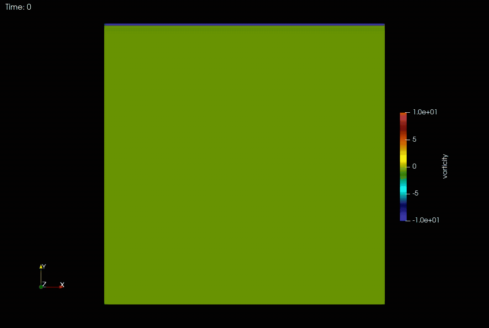

# cnavier

Explicit incompressible Navier–Stokes solver written in C, based on finite differences. It solves the two-dimensional equations in vorticity–streamfunction form, which removes the pressure and enforces incompressibility exactly. It runs on the CPU, optionally with OpenMP, or on an NVIDIA GPU.



*Vorticity field for the lid-driven cavity at Re=1000.*

## Method

```
∂ω/∂t + u·∂ω/∂x + v·∂ω/∂y = (1/Re) ∇²ω          (vorticity transport)
∇²ψ = −ω                                        (Poisson equation)
u = ∂ψ/∂y,  v = −∂ψ/∂x                          (velocity recovery)
```

Each step advances ω with Euler or RK4. Each stage recovers its velocity from a Poisson solve and its wall vorticity from that velocity. The discretisation, the boundary treatment, the verification and the performance are described in the **[methodology manual](docs/cnavier_methodology.pdf)** (source: [`docs/methodology.tex`](docs/methodology.tex)).

## Features

- **Finite differences** of order 2, 4 or 6; on periodic grids also Lele's sixth-order compact schemes and pseudospectral differentiation, with optional dealiasing.
- **Time integration**: explicit Euler or classical RK4, with the time step checked against the stability limits before a run.
- **Poisson solvers**: Gauss–Seidel, SOR, or a direct FFTW sine-transform solver (default), second or fourth order.
- **Cases**: the lid-driven cavity; on a doubly periodic square, the Taylor–Green vortex, a double shear layer, Kolmogorov flow, and forced and decaying 2-D turbulence. With `--geometry polar`, the flow past a circular cylinder on a log-polar grid, validated at Re = 40 against the reference solution of Gautier, Biau and Lamballais (2013).
- **2-D turbulence**: Kolmogorov and random forcing, drag, hyperviscosity, hypodrag and an enstrophy-conserving nonlinear term. Spectra and spectral fluxes satisfy exact discrete budgets.
- **Backends**: serial CPU, OpenMP, and an optional CUDA backend that runs the whole time loop on the GPU.
- **Output**: VTK files for ParaView, centerline profiles, domain integrals, spectra, and cylinder diagnostics.

## Quick start

Install a C compiler and FFTW3:

```bash
sudo apt install build-essential libfftw3-dev   # Ubuntu/Debian
sudo pacman -S fftw                             # Arch Linux
brew install fftw                               # macOS
```

Build and run the default case (the lid-driven cavity at Re = 100 on 64×64):

```bash
make
mkdir -p output
./cnavier
```

Optional builds (switching between them rebuilds everything automatically):

```bash
make OPENMP=1   # OpenMP: one thread per physical core unless OMP_NUM_THREADS is set
make CUDA=1     # GPU backend (needs the CUDA toolkit); --cpu runs the CPU path from the same binary
```

On macOS, OpenMP needs GCC from Homebrew (`brew install gcc`, then `CC=gcc-14 make OPENMP=1`). The manual covers GPU requirements, thread placement and timings.

## Cases

| Case | Example | What it shows |
|---|---|---|
| Lid-driven cavity (default) | `./cnavier --n 127 --dt 6.2e-4 --tf 20` | Steady cavity flow; centerline profiles against Ghia et al. (1982) |
| Taylor–Green vortex | `./cnavier --case taylor-green --n 64 --dt 0.001 --tf 0.5 --output-interval 0` | An exact solution; the run prints its error |
| Double shear layer | `./cnavier --case shear-layer --n 128 --re 10000 --dt 0.0005 --tf 1.2 --output-interval 800` | Shear layers rolling up into vortices |
| Kolmogorov flow | `./cnavier --case kolmogorov --n 128 --re 1000 --dt 5e-4 --tf 50 --output-interval 1000` | Instability of a forced laminar flow |
| Forced turbulence | `./cnavier --case forced --n 256 --re 10000 --dt 2e-4 --tf 100 --output-interval 5000` | The dual cascade of 2-D turbulence |
| Decaying turbulence | `./cnavier --case decaying --n 256 --re 2e4 --dt 9e-4 --tf 10 --output-interval 1000` | Vortices emerging and merging |
| Flow past a cylinder | `./cnavier --geometry polar --ntheta 128` | Steady wake at Re = 40, compared with Gautier et al. (2013) at the end |

The turbulence runs behind the manual's figures, with their parameters and `tools/` scripts, are listed in the manual.

## Options

Options not given keep the defaults at the top of `src/main.c`. The most common:

| Option | Description |
|---|---|
| `--n N`, `--nx N`, `--ny N` | Grid points (8 to 16384) |
| `--dt DT`, `--tf TF` | Time step and final time; a `dt` above the stability limits is refused with a value that passes |
| `--re RE` | Reynolds number |
| `--order N` | Finite differences of order 2, 4 or 6 (default), or `compact6` / `spectral` on periodic cases |
| `--case NAME` | `cavity` (default), `taylor-green`, `shear-layer`, `kolmogorov`, `forced`, `decaying` |
| `--geometry polar` | The flow past a cylinder (`--ntheta`, `--nr`, `--r-inf`, `--outer-bc`, `--steady-tol`) |
| `--output-interval N` | VTK every N steps (`0`: none) |
| `--cpu` | CUDA builds: run on the CPU |

`./cnavier --help` lists every option, and the manual's *Runtime options* table describes them.

## Output

Everything goes to `output/`:
- `vorticity-1-<n>.vtk`: VTK frames, for ParaView.
- `integrals.csv`: energy, enstrophy and palinstrophy over time.
- `spectrum-1-<n>.csv`: spectra and spectral fluxes, on periodic grids.
- `centerline_*_sim.csv`: centerline profiles, for the cavity.
- `cylinder_*.csv`: forces, wall data and the wake profile, for the cylinder.

## Tests

```bash
make test           # unit, convergence and solver tests (CPU)
make CUDA=1 test    # also checks the GPU backend against the CPU, on a machine with a GPU
make regression     # stored results, Ghia et al., Taylor–Green, Kolmogorov, cascade, cylinder
make test-cli       # invalid command lines are refused without writing anything
make convergence    # spatial convergence study against a manufactured solution
```

`make test-asan`, `make valgrind`, `make format-check`, `make cppcheck`, `make tidy` and `make WERROR=1` run the remaining checks. GitHub Actions runs all of them on every pull request, except the GPU comparisons, which need a GPU. The manual lists what each target checks and how to regenerate the stored results.

## Documentation

- [Methodology manual](docs/cnavier_methodology.pdf): equations, discretisation, solvers, boundary conditions, the polar grid, verification and validation, turbulence studies, performance, and every option. Source: [`docs/methodology.tex`](docs/methodology.tex).
- [Differentiation schemes in 2-D turbulence](docs/paper/cnavier_schemes.pdf): a paper-style draft comparing explicit, compact and pseudospectral differentiation, with the literature in [`docs/paper/literature_review.md`](docs/paper/literature_review.md).
- [Polar grid plan](docs/cylinder_polar_plan.md): the design of the cylinder solver and how the implementation departs from it.

## Project structure

```
cnavier/
├── src/            # solver: main.c (command line, time loop), fluiddyn.c (time step), poisson.c,
│                   # finitediff.c, fourier.c, polar.c + cylinder.c (polar grid), diagnostics.c,
│                   # forcing.c, backend.c, cudasolver.cu (GPU), linearalg.c, threads.c, utils.c
├── include/        # headers; fluiddyn.h holds solver_config, shared by both backends
├── tests/          # test_solver.c, test_polar.c, manufactured solutions, cli.sh, regression.sh,
│                   # reference/ (stored results, Ghia et al. data, cylinder reference values)
├── tools/          # post-processing: spectra and cascades, snapshots, scheme comparisons, cylinder
├── docs/           # methodology manual, paper draft, figures
└── output/         # results of the runs
```

## License

GNU General Public License v3.0; see [LICENSE](LICENSE).
